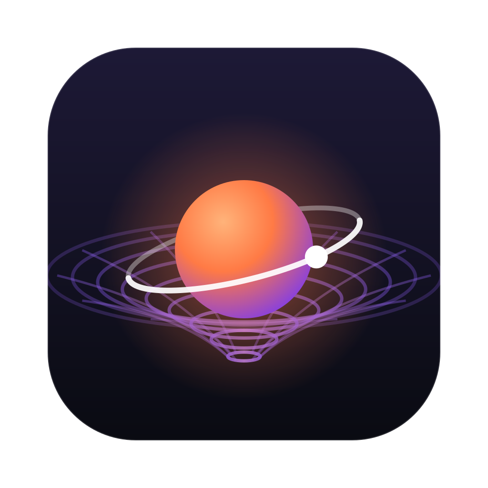

<p align="center"></p>

<h1 align="center">LastGravity</h1>

<p align="center"><b>A IDE agent-first, aberta e multi-modelo.</b><br>Agentes de IA que planejam, editam, rodam comandos e conferem o próprio trabalho — com você no controle.</p>

<p align="center">
  
  
  <a href="https://github.com/pblfrnc/lastgravity/actions/workflows/test.yml"></a>
  
  
  
</p>

<p align="center">
  <a href="#baixar-e-instalar">Baixar</a> ·
  <a href="#provedores-de-ia">Provedores</a> ·
  <a href="#myfriends">MyFriends</a> ·
  <a href="#terminal-cli">CLI</a> ·
  <a href="#desenvolvimento">Desenvolver</a>
</p>


IDE **agent-first**, aberta e **multi-modelo**: agentes de IA que planejam, editam arquivos, rodam comandos e verificam o próprio trabalho, com você no controle.

## Baixar e instalar

Baixe a versão do seu sistema em **[Releases](https://github.com/pblfrnc/lastgravity/releases/latest)**:

| Sistema | Arquivo |
|---|---|
| 🍎 Mac com chip Apple (M1–M4) | `LastGravity-mac-apple-silicon.zip` |
| 🍎 Mac Intel | `LastGravity-mac-intel.zip` |
| 🪟 Windows 10/11 (64 bits) | `LastGravity-windows-x64.zip` |
| 🐧 Linux (64 bits) | `LastGravity-linux-x64.tar.gz` |

### Aviso de "baixado da internet"

O app ainda não tem assinatura paga da Apple/Microsoft, então o sistema avisa na primeira vez que você abre:

- **Mac** — *"está danificado"* ou *"desenvolvedor não pode ser verificado"*: mova o app para **Aplicativos** e rode no Terminal
  ```bash
  xattr -cr /Applications/LastGravity.app
  ```
- **Windows** — *"O Windows protegeu o computador"*: antes de extrair, botão direito no `.zip` → **Propriedades** → marque **Desbloquear**. Se o aviso aparecer mesmo assim: **Mais informações → Executar assim mesmo**.
- **Linux** — `chmod +x lastgravity`; se reclamar do sandbox, rode `./lastgravity --no-sandbox`.

Passo a passo com todas as mensagens e alternativas: **[docs/INSTALAR.md](docs/INSTALAR.md)**.

### Compilar você mesmo

```bash
git clone https://github.com/pblfrnc/lastgravity.git
cd lastgravity
bash instalar-mac.sh     # Mac: compila, assina para o seu Mac, instala em Aplicativos e abre
npm install && npm run build:win     # Windows
npm install && npm run build:linux   # Linux
```

Sem app: `node bin/lastgravity.js /pasta/do/projeto` e abra http://localhost:4747 (Node 18+).

## Provedores de IA

Claude (Anthropic, **Amazon Bedrock**, **Google Vertex AI**), Gemini, OpenAI, **Azure AI Foundry**, OpenRouter, DeepSeek, Groq, Mistral, xAI, LM Studio, qualquer API compatível com OpenAI e **Ollama nativo** (grátis e offline, com tamanho de contexto configurável).
Em **⚙ Configurações → Chaves de API**: uma aba por provedor, testar conexão, buscar modelos, preços para calcular custo.

## Modo automático e segurança

- **⚙ → Geral → Aprovação**: Autônomo, Pedir antes de comandos (padrão) ou Pedir antes de tudo. Em um agente rodando: seletor no cabeçalho, `/auto` ou "Sempre aprovar".
- **Confiança na pasta**: em pastas novas o app abre em modo restrito (comandos sempre pedem aprovação e skills do projeto são ignoradas) até você clicar em **Confiar nesta pasta**. Protege contra repositórios baixados com instruções maliciosas.
- Agentes não saem da pasta do projeto (nem por atalhos/symlinks), comandos travados são encerrados com todos os processos filhos, chaves de API não vão para os comandos, envio de dados para sites externos pede aprovação, e o desfazer não apaga alterações feitas depois por você.

## Recursos

- **Editor + Gerenciador**: vários agentes em paralelo, plano visível, diff por arquivo, desfazer, uso de tokens e custo.
- **Texto em tempo real** (streaming) com novas tentativas automáticas quando a conexão cai.
- **Sub-agentes** `explore`, `plan`, `general`, `frontend` com **roteamento de modelo** (⚙ → Modelos): ex. planejar com um modelo forte e explorar com um local.
- **Ferramentas**: ler/editar/criar arquivos, `glob`, busca, terminal, **processos em segundo plano** (servidor de dev com porta detectada), **busca na web** e leitura de páginas, mapa do repositório, plano.
- **MCP** (stdio e HTTP) e **Skills** (pastas com `SKILL.md`) em ⚙ → MCP / Skills.
- **Imagens**: cole (⌘V), arraste ou anexe 📎 imagens na conversa.
- **Comandos**: `/model provedor:modelo`, `/auto`, `/fork`, `/usage`, `/repomap`, `/provider`, `/procs`, `/trust`, `/buddy`, `/help`.
- **Buddy**: mascote em pixel art que reage aos agentes (`/buddy nome Fulano`, `/buddy trocar`, `/buddy mudo`, `/buddy som`).
- **Tema claro, escuro ou do sistema** em ⚙ → Aparência.
- **Editor configurável**: fonte, tabulação, quebra de linha, minimapa, salvar automaticamente, limpeza ao salvar, seguir o agente.

## MyFriends

Faz o LastGravity, o **Claude Code**, o **OpenAI Codex** e o **Google Antigravity** conversarem e dividirem o trabalho na mesma máquina: quem está online, conversa por projeto, contexto compartilhado e fila de tarefas com reserva de arquivos.

Mensagens de outras IDEs aparecem sozinhas: aviso na tela, notificação do sistema e entrega automática ao agente para quem foram enviadas. Nas outras IDEs, a instalação liga o mesmo comportamento (Claude Code e Codex).

Vem instalado por padrão. Abra o painel **👥 Amigos** e use **Instalar** para levar a skill às outras IDEs, ou instale direto do repositório [pblfrnc/Myfriends](https://github.com/pblfrnc/Myfriends).

## Terminal (CLI)

```bash
lastgravity run "crie testes para utils.js" --provider ollama --approval auto
lastgravity run "refatore o módulo de login" --bg      # segundo plano
lastgravity ps · lastgravity logs <id> -f · lastgravity kill <id>
lastgravity run --continue "agora rode os testes"      # continua o último agente
lastgravity agents · lastgravity trust
lastgravity friends who · lastgravity friends send "oi" · lastgravity friends install
```

(`lastgravity` = `node bin/lastgravity.js`; com `npm link` vira comando global.)

## VS Code

Gere com `npm run build:vscode` e instale `dist/lastgravity-0.5.1.vsix` (Extensões → … → Instalar do VSIX). Comandos: **LastGravity: Abrir central de controle**, **Nova tarefa** (⌘⌥L) e, com texto selecionado, **Pedir ao agente sobre a seleção**.

## Desenvolvimento

```bash
npm install
npm test               # 7 conjuntos: ponta a ponta, MCP/skills, streaming, segurança, CLI, OpenRouter, MyFriends
npm run desktop        # app Electron
npm run build:mac      # LastGravity.app (Mac)
npm run build:win      # LastGravity.exe (Windows)
npm run build:linux    # lastgravity (Linux)
npm run build:vscode   # extensão .vsix
```

Estrutura: `src/` (servidor, agente, ferramentas, provedores, MCP, skills, CLI), `public/` (interface), `electron/` (app desktop), `vscode-extension/`, `test/`.

## Licença

[MIT](LICENSE). Ideias inspiradas em projetos como o OpenClaude, com todo o código escrito do zero.
